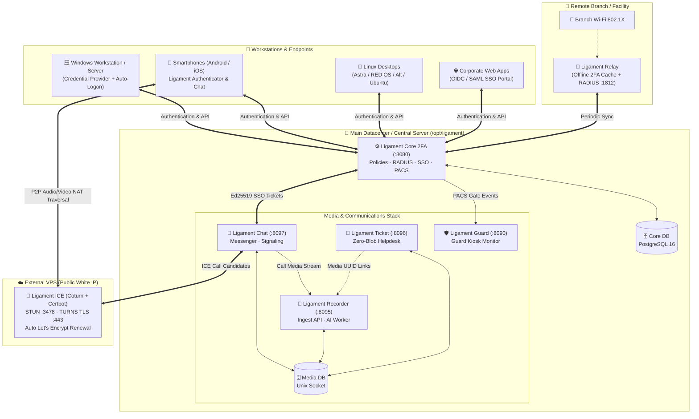

<div align="center">

# 🛡️ Ligament Enterprise Platform

**Autonomous On-Premise Multi-Factor Authentication (MFA/2FA), Secure Communications & Access Control Suite**

[](https://github.com/aligorov/ligament-apps/releases)
[](https://hub.docker.com/r/aligorov/ligament_2fa)
[]()
[]()
[]()
[]()
[]()

[Русский](README.ru.md) • **English**

[📌 Overview](#-overview) •
[🧩 7 Ecosystem Modules](#-7-core-ecosystem-modules) •
[🏛️ Architecture](#-system-architecture) •
[⚡ Quick Start](#-quick-start-in-2-minutes) •
[🌐 Distributed Deployment](#-distributed-deployment-core--vps-ice--branch-relay) •
[🔄 Updates & Maintenance](#-updates--zero-downtime-maintenance) •
[📊 Requirements & Ports](#-system-requirements--port-matrix) •
[📱 Client Applications](#-client-applications--enterprise-os-support) •
[🔑 Editions & Licensing](#-editions--licensing) •
[📬 Contacts](#-contacts)

---

</div>

## 📌 Overview

**Ligament** (Latin: *binding ligament*) is an independent, sovereign, self-hosted (On-Premise) cybersecurity and identity platform combining enterprise multi-factor authentication (MFA / 2FA), corporate messaging, session recording with AI analysis, physical access control (PACS), and guard kiosk monitoring.

The platform bridges together every tier of corporate infrastructure:
- 🖥️ **Windows Workstations & Servers**: Native Credential Provider (LogonUI, RDP, console) with Auto-Logon and Number Matching.
- 🌐 **Network Perimeter & VPN**: RADIUS (PAP, EAP-TTLS, PEAP) for MikroTik, Cisco, Fortinet, Check Point, OpenVPN, WireGuard.
- 🔑 **Single Sign-On (SSO)**: OIDC (OpenID Connect) and SAML 2.0 Identity Provider for corporate portals and web apps.
- 💬 **Secure Communications**: Enterprise E2E messenger and P2P WebRTC audio/video calls without external clouds.
- 🎥 **Session Auditing**: Screen, call, and audio conference recording with AI transcription and summarization.
- 🎫 **Incident Response**: Zero-Blob helpdesk & ticketing tied directly to session recordings and audit timelines.
- 🏢 **Physical Security & PACS**: Gate/turnstile controller integration and Guard Kiosk monitor with anti-tailgating.
- 📡 **Branch Autonomy**: Edge relay nodes for offline authentication and secure bastion access.

> 🔒 **Zero-Leakage & Air-Gapped Philosophy:**
> Databases, Ed25519 cryptographic keys, tokens, biometric hashes, message threads, and video archives stay strictly within your perimeter. The platform is completely decoupled from foreign SaaS providers and operates smoothly in isolated air-gapped environments.

---

## 🧩 7 Core Ecosystem Modules

Ligament is designed modularly: deploy everything as a unified **All-in-One** stack or distribute roles across separate hosts.

```
┌────────────────────────────────────────────────────────────────────────────────────────┐
│                                LIGAMENT ENTERPRISE SUITE                               │
├─────────────────────┬─────────────────────┬─────────────────────┬──────────────────────┤
│ 🛡️ CORE (2FA / IAM) │ 💬 LIGAMENT CHAT    │ 🎥 LIGAMENT RECORDER│ 🎫 LIGAMENT TICKET   │
│ MFA, SSO, RADIUS,   │ Corporate chat,     │ Session & call video│ Zero-Blob helpdesk,  │
│ PACS, WebUI, Audit  │ P2P WebRTC calls    │ Ingest API, AI-work │ incident management  │
├─────────────────────┼─────────────────────┼─────────────────────┴──────────────────────┤
│ 🛡️ LIGAMENT GUARD   │ 📡 LIGAMENT RELAY   │ 🧊 LIGAMENT ICE                            │
│ Guard Kiosk monitor,│ Branch edge agent,  │ Public STUN/TURN/TURNS media gateway       │
│ anti-tailgating     │ offline 2FA cache   │ with automatic Let's Encrypt Certbot       │
└─────────────────────┴─────────────────────┴────────────────────────────────────────────┘
```

### 1. 🛡️ Ligament Core (Platform Engine)
* **Image:** `aligorov/ligament_2fa:latest` · **Ports:** `:8080` (WebUI/API), `:80` (HTTP), `:1812/udp` (RADIUS Auth), `:1813/udp` (RADIUS Acct).
* **Role:** The brain of the platform. Manages identities, directories (Active Directory / OpenLDAP / Local), push notifications, TOTP tokens, FIDO2/WebAuthn hardware keys, OIDC/SAML IdP, hardware node-locking, and audit logging.
* **Database:** Dedicated PostgreSQL 16 Alpine container with CSPRNG password isolation.

### 2. 💬 Ligament Chat (Corporate Messenger)
* **Image:** `aligorov/ligament_chat:latest` · **Port:** `:8097` (Web/WebSockets).
* **Role:** End-to-end secure corporate messenger for desktop and mobile. Supports direct messages, channels, file sharing, and P2P WebRTC audio/video calls.
* **Architecture Highlights:**
  - **High-Water Mark:** Read markers stored without full-table writes ($O(1)$ complexity).
  - **Unified SSO Realm:** Seamless login via Core Ed25519 SSO tickets (`aud: ligament-chat`).

### 3. 🎥 Ligament Recorder (Media Server & AI Worker)
* **Image:** `aligorov/ligament_recoder:latest` · **Port:** `:8095` (Ingest API).
* **Role:** Captures audio/video streams of WebRTC calls, screen recordings, and remote help sessions. Features an embedded AI worker for speech-to-text transcription, meeting summaries, and audio search.
* **Architecture Highlights:**
  - **Zero-ENV:** Secret leak protection through environment rejection. Peer authentication via Unix domain socket.
  - **Durable ACK:** Frame acknowledgement only after transactional persistence.

### 4. 🎫 Ligament Ticket (Helpdesk & Incident Response)
* **Image:** `aligorov/ligament_ticket:latest` · **Port:** `:8096` (HTTP).
* **Role:** Helpdesk and incident tracking system.
* **Architecture Highlights:**
  - **Zero-Blob Architecture:** Never stores heavy binary blobs in its database. Media files link to `media_id UUID` stored inside Ligament Recorder.

### 5. 🛡️ Ligament Guard (Guard Kiosk Monitor)
* **Image:** `aligorov/ligament_guard:latest` · **Port:** `:8090` (HTTP/SSE).
* **Role:** Kiosk interface tailored for security guards at facility gates and turnstiles.
* **Capabilities:**
  - Real-time Server-Sent Events (SSE) passage stream.
  - Turnstile passage deduplication and anti-tailgating detection.
  - Photo prefetching from Core database with 2FA badge indicators.

### 6. 📡 Ligament Relay (Branch Edge Agent)
* **Image:** `aligorov/ligament-relay:latest` · **Ports:** `:8082` (HTTP), `:1812/udp` (RADIUS), `:5353/udp` (mDNS).
* **Role:** Deployed at remote branch offices or isolated subnets. Caches 2FA hashes locally to authenticate Wi-Fi/VPN users during internet outages. Functions as an obfuscated blind-pipe bastion (compiled with Garble Tiny).

### 7. 🧊 Ligament ICE (WebRTC STUN/TURN/TURNS Media Gateway)
* **Image:** `coturn:4.6.2-alpine` + `certbot:latest` · **Ports:** `:3478` (STUN/TURN), `:443` (TURNS TLS), `:49152-49250/udp` (Relay).
* **Role:** Deployed on an external public VPS with a public IP. Transits WebRTC audio/video calls across corporate Symmetric NATs and mobile carriers.
* **Auto-SSL:** Automated Certbot container acquires and auto-renews Let's Encrypt TLS certificates every 12 hours.

---

## 🏛️ System Architecture



---

## ⚡ Quick Start in 2 Minutes

Install with a single command. The installer detects the environment, checks hardware requirements, resolves port conflicts, configures Docker Hub registry mirrors if necessary, and deploys the stack.

### 🚀 Quick Installation

```bash
curl -fsSL https://raw.githubusercontent.com/aligorov/ligament/main/install.sh -o install.sh && bash install.sh
```
*(Or single-line pipe: `curl -fsSL https://raw.githubusercontent.com/aligorov/ligament/main/install.sh | bash`)*

### 💻 Interactive TUI Terminal

Running `./install.sh` in an interactive terminal launches the ANSI-based text UI:

```text
╔═══════════════════════════════════════════════════════════════════════╗
║  🛡️  LIGAMENT ENTERPRISE PLATFORM — INSTALLER & ORCHESTRATOR         ║
║  Version: 2.3.0 · Working Dir: ligament                               ║
╚═══════════════════════════════════════════════════════════════════════╝

  MODULE                 DOCKER STATUS              PORTS            HOST DATA VOLUME
  ────────────────────── ────────────────────────── ──────────────── ───────────────────────────────────
  🛡️ Core 2FA (Auth)     · Not installed            (recom: :8080)   twofa_pgdata
  💬 Ligament Chat       · Not installed            (recom: :8097)   chat_pgdata
  📹 Recorder & AI       · Not installed            (recom: :8095)   recorder_pgdata
  🎫 Helpdesk Ticket     · Not installed            (recom: :8096)   ticket_pgdata
  🪪 Guard Monitor       · Not installed            (recom: :8090)   —
  🧊 WebRTC ICE (VPS)    · Not installed            (recom: :5349)   ligament_ice_certs
  📡 Branch Relay        · Not installed            (recom: :8082)   —
  ─────────────────────────────────────────────────────────────────────────────────────────────

  Choose action or module to deploy:

  [1] 🚀 All-in-One Enterprise (Deploy entire platform stack)
      Core 2FA + Chat + Recorder + Ticket + Guard

  [2] 🛡️  Core 2FA Security Core (Base security core + Web + RADIUS)
  [3] 💬 Ligament Chat (Corporate messenger + P2P WebRTC signaling)
  [4] 📹 Ligament Recorder & AI (Session/call recorder + AI Worker)
  [5] 🎫 Ligament Ticket (Helpdesk & incident system)
  [6] 🪪 Ligament Guard (Kiosk monitor for checkpoints & turnstiles)
  ──────────────────────────────────────────────────────────────────────
  [7] 🧊 Ligament ICE (Media gateway Coturn STUN/TURN on VPS)
  [8] 📡 Ligament Relay (Branch office edge agent)
  ──────────────────────────────────────────────────────────────────────
  [9] 🔄 Update containers (Pull & Restart)
  [10] 📊 Detailed inspection of paths, volumes, ports & logs
  [11] 🗑️  Removal (Remove module or entire stack)
  [0] ❌ Exit
```

### ⚙️ Non-Interactive CLI Automation (CI/CD)

```bash
# Full Enterprise suite deployment
./install.sh --all

# Minimal 2FA core only
./install.sh --core-only

# Custom module selection
./install.sh --modules core,chat,guard

# Custom directory and pinned image version
./install.sh --dir /srv/ligament --tag latest

# Clean fresh install wiping previous volumes
./install.sh --fresh
```

### 🔑 Initial Admin Access

Upon completion, the installer displays the summary:
* **Admin Dashboard URL:** `http://SERVER_IP:8080` (or port `:80`)
* **Admin Username:** `admin`
* **Master Password:** Saved in `./admin_password.txt` (`chmod 600`)
* **Recovery Codes:** Saved in `./admin_recovery_codes.txt` (5 single-use codes)
* **Secrets & Config:** Saved in `./.env` (`chmod 600`)

---

## 🌐 Distributed Deployment (Core + VPS ICE + Branch Relay)

For production, roles should be physically decoupled:

### 1. Central Server (Datacenter / Headquarters)
Deploy central core and internal services:
```bash
./install.sh --modules core,chat,recorder,ticket,guard
```

### 2. WebRTC ICE Media Gateway (Public Cloud VPS)
Deploy the media gateway on a VPS with a public IPv4 address:

* **Option A: Remote SSH deployment from central server:**
  ```bash
  ./install.sh --deploy-remote-ice vps.yourdomain.com --ice-realm turn.yourdomain.com --ice-email admin@yourdomain.com
  ```
* **Option B: Direct installation on the VPS:**
  ```bash
  curl -fsSL https://raw.githubusercontent.com/aligorov/ligament/main/install.sh | bash -s -- --role ice --ice-realm turn.yourdomain.com
  ```

### 3. Edge Relay Node (Remote Branch Office)
Deploy the relay in the branch office LAN:

* **Option A: Remote SSH deployment:**
  ```bash
  ./install.sh --deploy-remote-relay branch-router.local
  ```
* **Option B: Direct installation at the branch:**
  ```bash
  curl -fsSL https://raw.githubusercontent.com/aligorov/ligament/main/install.sh | bash -s -- --role relay
  ```

---

## 🔄 Updates & Zero-Downtime Maintenance

Update containers seamlessly without stopping the whole stack:

### 1. Update All Running Modules
```bash
./install.sh --update
```

### 2. Update a Single Service (Zero-Downtime)
Recreate only the targeted container without disconnecting databases or peer services:
```bash
./install.sh --update-module chat       # Updates aligorov/ligament_chat
./install.sh --update-module twofa      # Updates Core 2FA
./install.sh --update-module recorder   # Updates Media Server
./install.sh --update-module guard      # Updates Guard Monitor
```

> [!TIP]
> Under the hood, the script executes `docker compose up -d --no-deps <service>`, keeping database connections and peer containers running uninterrupted.

### 3. Module Removal & Uninstallation
Stop and remove an individual service (e.g. if moving to a dedicated node):
```bash
./install.sh --remove-module guard      # Removes only Guard container; other services unaffected
./install.sh --remove-module chat       # Removes Chat & Chat-DB (with prompt to remove data volumes)
```
Full uninstallation of all Ligament services:
```bash
./install.sh --uninstall-all            # Interactive dialog confirming container, volume & config deletion
./install.sh --uninstall-all --purge-volumes --purge-files # Complete silent host purge
```
In interactive TUI, choose option `[11] 🗑️  Removal` to manage component deletion.

---

## 📊 System Requirements & Port Matrix

### 🖥️ Minimum vs Recommended Requirements

| Deployment Profile | CPU Cores | RAM | Storage | Recommended OS |
|---|---|---|---|---|
| **Core Only (2FA)** | 2 Cores | 2 GB | 10 GB SSD / NVMe | Ubuntu 22.04/24.04, Debian 12, Astra 1.7, RED OS 8 |
| **All-in-One Enterprise** | 4 Cores | 8 GB | 50+ GB NVMe (for video) | Ubuntu 22.04/24.04, Debian 12, RHEL 9 |
| **ICE Gateway (VPS)** | 1–2 Cores | 1 GB | 5 GB SSD | Any Linux VPS with public IPv4 |
| **Relay Node (Branch)** | 1–2 Cores | 1 GB | 5 GB SSD | Mini-PC, MicroServer or VM |

### 🔌 Network Ports & Protocols

| Module | Port | Protocol | Scope | Purpose |
|---|---|---|---|---|
| **Core WebUI / API** | `8080` / `80` | TCP | Inbound | Admin Panel, User Portal, OIDC/SAML endpoints |
| **Core RADIUS** | `1812` | UDP | Inbound | VPN & Wi-Fi 802.1X authentication |
| **Core Accounting** | `1813` | UDP | Inbound | RADIUS session accounting |
| **Chat** | `8097` | TCP | Inbound | Client chat connections (HTTP + WebSockets) |
| **Recorder** | `8095` | TCP | Internal | Media stream Ingest API |
| **Ticket** | `8096` | TCP | Inbound | Helpdesk & Incident management web UI |
| **Guard** | `8090` | TCP | Inbound | SSE turnstile event stream for guard monitors |
| **Relay** | `8082` | TCP | Inbound (LAN) | Branch local API and LAN Push delivery |
| **Relay mDNS** | `5353` | UDP | Local LAN | Subnet agent auto-discovery |
| **ICE STUN/TURN** | `3478` | TCP / UDP | Inbound (VPS) | Standard STUN/TURN signaling |
| **ICE TURNS (TLS)** | `443` | TCP / UDP | Inbound (VPS) | TLS TURN relay traffic (strict firewalls) |
| **ICE Dynamic Relay**| `49152–49250`| UDP | Inbound (VPS) | WebRTC dynamic media packet range |
| **PostgreSQL** | `5432` | TCP / Socket | **Docker Internal** | Database (never exposed to host) |

---

## 📱 Client Applications & Enterprise OS Support

Official client distributions are hosted in [**ligament-apps/releases**](https://github.com/aligorov/ligament-apps/releases):

| Component | Target Platform | Package Format | Purpose |
|---|---|---|---|
| **Windows Credential Provider** | Windows 10, 11, Server 2016–2025 | `.msi`, `.zip` | Native LogonUI module: 2FA on local login and RDP, Auto-Logon, Number Matching, UAC elevation |
| **Ligament Authenticator** | Android | `.apk` | Mobile app with Push, TOTP, Number Matching, and biometrics |
| **Ligament Authenticator** | iOS | App Store / TestFlight | Mobile app for iPhone/iPad |
| **Ligament Desktop** | Linux, macOS, Windows | `.deb`, `.rpm`, `.dmg`, `.exe` | Desktop client for employee workstations |

### 🐧 Russian Enterprise Linux Support

Client packages are pre-built and validated across enterprise Linux distributions:

| Operating System | Package Type | Architecture | Quick Install Command |
|---|---|---|---|
| **Astra Linux** (Special Edition 1.7 / CE) | `.deb` | `amd64` | `sudo dpkg -i ligament-authenticator_*.deb \|\| sudo apt-get install -f` |
| **RED OS** (versions 7.3, 8) | `.rpm` | `x86_64` | `sudo dnf install ./ligament-authenticator-*.rpm` |
| **Alt Linux Workstation / SPT** (p9, p10) | `.rpm` | `x86_64` | `sudo epm install ./ligament-authenticator-*.rpm` |
| **Ubuntu / Debian / Linux Mint** | `.deb` | `amd64` | `sudo apt install ./ligament-authenticator_*.deb` |
| **Universal Portable** | `.tar.gz` | `x86_64` | `tar -xzf Ligament-Linux-x86_64.tar.gz && ./install.sh` |

---

## 📊 Editions & Licensing

| Edition | Intended For | User Limit | Duration |
|---|---|---|---|
| 🟢 **Free (Community)** | Homelabs, micro-teams, protecting admin accounts | Up to 5 users | Lifetime |
| 🟡 **Demo (Trial)** | Full pilot testing of all Enterprise capabilities | Unlimited | 30 Days (Node-locked to server) |
| 🔵 **Subscription** | Production deployment with vendor support | By seat count | Active subscription period |
| 🟣 **Perpetual (CapEx)** | Perpetual corporate license (Self-hosted) | By seat count | Lifetime |

### 🔍 Feature Breakdown

* **Included in Free:** All core 2FA factors (TOTP, Telegram, Push, SMS, Email), Windows Credential Provider with Auto-Logon and Number Matching, RADIUS server (VPN/Wi-Fi), user self-service portal, standard audit log.
* **Unlocked in Demo & Commercial Licenses:**
  - 🔑 **OIDC / SAML Identity Provider (SSO)** for corporate web apps.
  - 🏢 **Active Directory / OpenLDAP synchronization**.
  - 💬 **Ligament Chat corporate messenger** with P2P WebRTC.
  - 🎥 **Ligament Recorder** session capture and AI worker.
  - 🎫 **Zero-Blob Ligament Ticket** helpdesk.
  - 🛡️ **Ligament Guard** Kiosk monitor and PACS controller integrations.
  - 📡 **Unlimited Ligament Relay edge nodes**.
  - 🌐 **Geo-IP filtering, Web-SSH/RDP bastion, sponsored guest access**.
  - 🏷️ **White-Labeling**.

---

## 🔑 License Activation

Activation is performed cryptographically via the web console:

1. In the Core Web Admin panel, navigate to **Settings → License** and copy your **Server Activation Code** (hardware fingerprint).
2. Request a trial or commercial license key from support by providing your activation code and company name.
3. You will receive a cryptographically signed license file (`.lic`), activated with one click in the web UI without service restarts.

---

## 📄 Documentation & Presentation

* 📊 **Official Presentation (PDF v4)**: [`presentation/v4/Ligament-Обзор-2026-10-10.pdf`](presentation/v4/Ligament-Обзор-2026-10-10.pdf) — 22 slides covering architecture, competitive comparisons against Cisco Duo, Protectimus, SafeNet, and implementation patterns.
* 🌐 **Interactive HTML Deck**: [`presentation/v4/Ligament-Обзор-2026-10-10.html`](presentation/v4/Ligament-Обзор-2026-10-10.html).
* 🛡️ **Security Audit Report**: [`security_best_practices_report.md`](security_best_practices_report.md).
* 🧩 **Client Applications Repository**: [aligorov/ligament-apps](https://github.com/aligorov/ligament-apps).

---

## 📬 Contacts & Community

* 🌐 **GitHub Repository:** [aligorov/ligament](https://github.com/aligorov/ligament)
* 🧩 **Client Applications:** [aligorov/ligament-apps](https://github.com/aligorov/ligament-apps)
* 💬 **Issue Tracker & Discussions:** [GitHub Issues](https://github.com/aligorov/ligament/issues)

<div align="center">
  <sub>© 2026 Ligament Security. All rights reserved. Self-Hosted Sovereign Enterprise MFA & Cyber-Security Platform.</sub>
</div>
