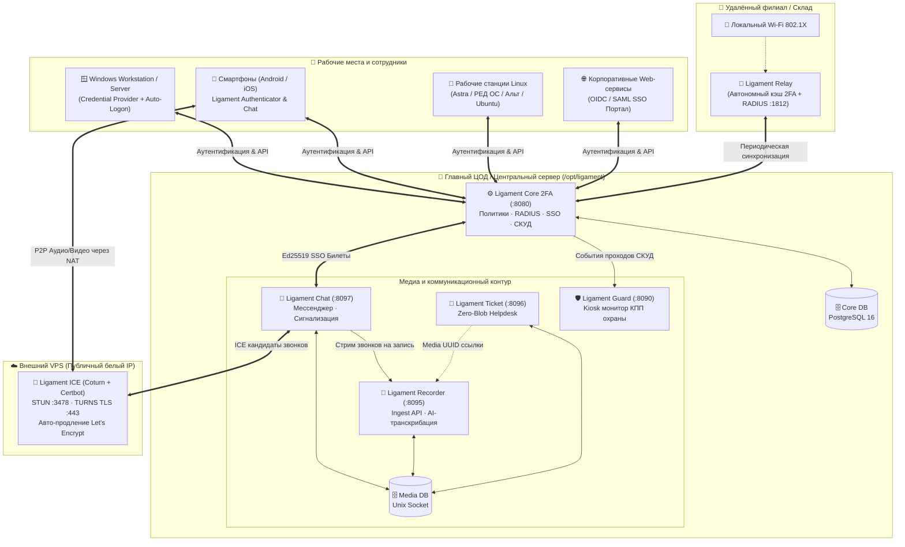

<div align="center">

# 🛡️ Ligament Enterprise Platform

**Автономная многофакторная аутентификация (MFA/2FA), корпоративные коммуникации и контроль доступа на вашей собственной инфраструктуре**

[](https://github.com/aligorov/ligament-apps/releases)
[](https://hub.docker.com/r/aligorov/ligament_2fa)
[]()
[]()
[]()
[]()
[]()

**Русский** • [English](README.md)

[📌 О платформе](#-о-платформе) •
[🧩 7 Модулей экосистемы](#-7-ключевых-модулей-экосистемы) •
[🏛️ Архитектура](#-архитектура-решения) •
[⚡ Быстрый старт](#-быстрый-старт-за-2-минуты) •
[🌐 Распределённое развёртывание](#-распределённое-развёртывание-центр--vps--филиал) •
[🔄 Обновление и сопровождение](#-обновление-и-сопровождение) •
[📊 Системные требования и порты](#-системные-требования-и-матрица-портов) •
[📱 Клиенты и ОС РФ](#-клиентские-приложения-и-поддержка-ос-рф) •
[🔑 Редакции и лицензирование](#-редакции-и-лицензирование) •
[📬 Контакты](#-контакты)

---

</div>

## 📌 О платформе

**Ligament** (от лат. *связка*) — это независимая, полностью локальная (On-Premise / Self-Hosted) экосистема кибербезопасности, объединяющая многофакторную аутентификацию (MFA / 2FA), корпоративные коммуникации, запись сессий с AI-анализом, интеграцию со СКУД и мониторинг КПП.

Платформа связывает воедино все рубежи корпоративной ИТ-инфраструктуры:
- 🖥️ **Рабочие станции и серверы Windows**: нативный Credential Provider (LogonUI, RDP, консоль) с интеллектуальным Auto-Logon и Number Matching.
- 🌐 **Сетевой периметр и VPN**: RADIUS (PAP, EAP-TTLS, PEAP) для MikroTik, Cisco, Fortinet, Check Point, OpenVPN, WireGuard.
- 🔑 **Единая точка входа (SSO)**: OIDC (OpenID Connect) и SAML 2.0 Identity Provider для корпоративных веб-сервисов и корпоративных порталов.
- 💬 **Защищённые коммуникации**: корпоративный E2E-мессенджер и P2P WebRTC аудио/видео звонки без внешних облаков.
- 🎥 **Аудит и контроль сессий**: запись звонков, экранов и аудиоконференций с последующей AI-транскрибацией и саммаризацией.
- 🎫 **Управление инцидентами**: Zero-Blob система тикетов и заявок с мгновенной привязкой к видеозаписям и таймлайну аудита.
- 🏢 **Физическая безопасность и СКУД**: интеграция с турникетами (Болид / RusGuard / Perco / Sigur) и Kiosk-монитор КПП для охраны.
- 📡 **Филиальная автономия**: локальные узлы Ligament Relay для работы без интернета и безопасного бастионного доступа.

> 🔒 **Принцип абсолютного суверенитета данных (Zero-Leakage & Air-Gapped):**
> Все базы данных, криптографические ключи Ed25519, токены, биометрические хэши, переписка и видеоархивы хранятся строго в вашем периметре. Платформа не зависит от зарубежных SaaS-провайдеров и стабильно работает в изолированных сетях без доступа в интернет.

---

## 🧩 7 Ключевых модулей экосистемы

Экосистема Ligament построена по модульному принципу: вы можете запустить как единый монолит **All-in-One**, так и распределить роли по разным серверам.

```
┌────────────────────────────────────────────────────────────────────────────────────────┐
│                                LIGAMENT ENTERPRISE SUITE                               │
├─────────────────────┬─────────────────────┬─────────────────────┬──────────────────────┤
│ 🛡️ CORE (2FA / IAM) │ 💬 LIGAMENT CHAT    │ 🎥 LIGAMENT RECORDER│ 🎫 LIGAMENT TICKET   │
│ MFA, SSO, RADIUS,   │ Корпоративный чат,  │ Запись звонков/видео│ Helpdesk, инциденты, │
│ СКУД, WebUI, Аудит  │ P2P WebRTC звонки   │ Ingest API, AI-worker│ Zero-Blob привязка  │
├─────────────────────┼─────────────────────┼─────────────────────┴──────────────────────┤
│ 🛡️ LIGAMENT GUARD   │ 📡 LIGAMENT RELAY   │ 🧊 LIGAMENT ICE                            │
│ Монитор КПП охраны, │ Edge-агент филиала, │ Публичный STUN/TURN/TURNS медиа-шлюз       │
│ анти-тейлгейтинг    │ оффлайн-кэш 2FA     │ с автоматическим Let's Encrypt Certbot     │
└─────────────────────┴─────────────────────┴────────────────────────────────────────────┘
```

### 1. 🛡️ Ligament Core (Ядро платформы)
* **Образ:** `aligorov/ligament_2fa:latest` · **Порты:** `:8080` (WebUI/API), `:80` (HTTP), `:1812/udp` (RADIUS Auth), `:1813/udp` (RADIUS Acct).
* **Назначение:** Мозг платформы. Управляет учетными записями, каталогами (Active Directory / OpenLDAP / Local), выдачей push-уведомлений, TOTP-токенами, аппаратными FIDO2/WebAuthn ключами, OIDC/SAML провайдером, аппаратной привязкой лицензий и журналом аудита.
* **СУБД:** Выделенный PostgreSQL 16 с защитой паролем на уровне CSPRNG.

### 2. 💬 Ligament Chat (Корпоративный мессенджер)
* **Образ:** `aligorov/ligament_chat:latest` · **Порт:** `:8097` (Web/WebSockets).
* **Назначение:** Защищённый корпоративный мессенджер для десктопа и смартфонов. Поддерживает личные и групповые чаты, каналы, передачу файлов и P2P WebRTC аудио/видео звонки.
* **Архитектурные особенности:**
  - **High-Water Mark:** отметки прочтения хранятся без разрастания базы (O(1) сложность).
  - **Единый контур SSO:** прозрачный вход по Ed25519 SSO-билетам ядра (`aud: ligament-chat`).

### 3. 🎥 Ligament Recorder (Медиа-сервер и AI-анализ)
* **Образ:** `aligorov/ligament_recoder:latest` · **Порт:** `:8095` (Ingest API).
* **Назначение:** Захват и долговременное хранение аудио/видео потоков WebRTC звонков, скриншотов экранов и сессий удалённой помощи. Включает встроенный AI-воркер для автоматической расшифровки речи (Speech-to-Text), составления протокола встречи и поиска по аудиозаписям.
* **Архитектурные особенности:**
  - **Zero-ENV:** защита от утечек секретов через переменные среды. Peer authentication через Unix domain socket.
  - **Durable ACK:** подтверждение приёма кадров только после транзакционной фиксации.

### 4. 🎫 Ligament Ticket (Helpdesk и инцидент-менеджмент)
* **Образ:** `aligorov/ligament_ticket:latest` · **Порт:** `:8096` (HTTP).
* **Назначение:** Система обработки заявок пользователей, запросов на доступ и расследования инцидентов ИБ.
* **Архитектурные особенности:**
  - **Zero-Blob Architecture:** тикет-система не хранит тяжёлые файлы и видео в своей БД. Все медиа-материалы ссылаются на `media_id UUID` в Ligament Recorder, исключая фрагментацию диска.

### 5. 🛡️ Ligament Guard (Монитор КПП охраны)
* **Образ:** `aligorov/ligament_guard:latest` · **Порт:** `:8090` (HTTP/SSE).
* **Назначение:** Специализированный Kiosk-интерфейс для мониторов сотрудников службы безопасности на проходных.
* **Возможности:**
  - Реалтайм-лента проходов через турникеты СКУД по Server-Sent Events (SSE).
  - Дедупликация повторных прикладываний карт и распознавание прохода «паровозиком» (Anti-Tailgating).
  - Мгновенный предзаказ (prefetch) фото сотрудника из базы Core и отображение статуса 2FA-подтверждения.

### 6. 📡 Ligament Relay (Периферийный edge-агент филиала)
* **Образ:** `aligorov/ligament-relay:latest` · **Порты:** `:8082` (HTTP), `:1812/udp` (RADIUS), `:5353/udp` (mDNS).
* **Назначение:** Разворачивается в удалённых офисах, складах и филиалах. Кэширует базу хешей 2FA локально, обеспечивая бесперебойный вход сотрудников по Wi-Fi/VPN даже при полном обрыве магистрального интернет-канала до центра. Работает в режиме защищённого бастиона («слепая труба»). Скомпилирован с защитой Garble Tiny.

### 7. 🧊 Ligament ICE (WebRTC STUN/TURN/TURNS Медиа-шлюз)
* **Образ:** `coturn:4.6.2-alpine` + `certbot:latest` · **Порты:** `:3478` (STUN/TURN), `:443` (TURNS TLS), `:49152-49250/udp` (Relay).
* **Назначение:** Разворачивается на публичном VPS с «белым» IP-адресом. Позволяет WebRTC звонкам и видеопотокам пробивать жесткие корпоративные Symmetric NAT, межсетевые экраны и мобильные сети операторов с гарантированным качеством связи.
* **Авто-SSL:** Встроенный контейнер Certbot автоматически выпускает и каждые 12 часов продлевает TLS-сертификаты Let's Encrypt.

---

## 🏛️ Архитектура решения



---

## ⚡ Быстрый старт за 2 минуты

Установка выполняется одной командой. Скрипт сам определит окружение, проверит системные требования, подберёт свободные порты, при необходимости настроит зеркала Docker Hub для РФ и запустит платформу.

### 🚀 Быстрая установка

```bash
curl -fsSL https://raw.githubusercontent.com/aligorov/ligament/main/install.sh -o install.sh && bash install.sh
```
*(Или в одну строку через пайп: `curl -fsSL https://raw.githubusercontent.com/aligorov/ligament/main/install.sh | bash`)*

### 💻 Интерактивное TUI-меню

Если запустить `./install.sh` без параметров в терминале, откроется интерактивный псевдографический интерфейс:

```text
╔═══════════════════════════════════════════════════════════════════════╗
║  🛡️  LIGAMENT ENTERPRISE PLATFORM — УСТАНОВКА И ОРКЕСТРАЦИЯ         ║
║  Версия: 2.3.0 · Каталог: ligament                                    ║
╚═══════════════════════════════════════════════════════════════════════╝

  МОДУЛЬ                 СТАТУС В DOCKER            ПОРТЫ            ТОМ ДАННЫХ НА ХОСТЕ
  ────────────────────── ────────────────────────── ──────────────── ───────────────────────────────────
  🛡️ Core 2FA (Auth)     · Не установлен            (реком: :8080)   twofa_pgdata
  💬 Ligament Chat       · Не установлен            (реком: :8097)   chat_pgdata
  📹 Recorder & AI       · Не установлен            (реком: :8095)   recorder_pgdata
  🎫 Helpdesk Ticket     · Не установлен            (реком: :8096)   ticket_pgdata
  🪪 Guard Monitor       · Не установлен            (реком: :8090)   —
  🧊 WebRTC ICE (VPS)    · Не установлен            (реком: :5349)   ligament_ice_certs
  📡 Branch Relay        · Не установлен            (реком: :8082)   —
  ─────────────────────────────────────────────────────────────────────────────────────────────

  Выберите действие или модуль для установки:

  [1] 🚀 All-in-One Enterprise (Развернуть весь стек модулей разом)
      Core 2FA + Chat + Recorder + Ticket + Guard

  [2] 🛡️  Core 2FA Security Core (Базовое ядро безопасности + Web + RADIUS)
  [3] 💬 Ligament Chat (Корпоративный мессенджер + P2P WebRTC сигнализация)
  [4] 📹 Ligament Recorder & AI (Запись сессий/звонков + AI Worker)
  [5] 🎫 Ligament Ticket (Helpdesk & система инцидентов)
  [6] 🪪 Ligament Guard (Kiosk монитор КПП и турникетов)
  ──────────────────────────────────────────────────────────────────────
  [7] 🧊 Ligament ICE (Медиа-шлюз Coturn STUN/TURN на VPS)
  [8] 📡 Ligament Relay (Edge-агент филиала)
  ──────────────────────────────────────────────────────────────────────
  [9] 🔄 Обновление контейнеров (Pull & Restart)
  [10] 📊 Детальная инспекция путей, томов, портов и логи
  [11] 🗑️  Удаление (Удалить модуль или весь стек)
  [0] ❌ Выход
```

### ⚙️ Неинтерактивные флаги для CI/CD и скриптов

```bash
# Установка полного стека Enterprise
./install.sh --all

# Установка только базового ядра 2FA
./install.sh --core-only

# Выборочная установка необходимых модулей
./install.sh --modules core,chat,guard

# Установка в нестандартный каталог с пином конкретной версии
./install.sh --dir /srv/ligament --tag latest

# Чистый запуск со сбросом старых баз данных
./install.sh --fresh
```

### 🔑 Вход в панель управления после установки

По завершении работы установщик выведет итоговую сводку:
* **URL панели управления:** `http://IP-сервера:8080` (или порт `:80`)
* **Логин администратора:** `admin`
* **Мастер-пароль:** сохранён в `./admin_password.txt` (права `chmod 600`)
* **Одноразовые аварийные коды:** сохранены в `./admin_recovery_codes.txt` (5 кодов на случай утери доступа)
* **Конфигурация и пароль БД:** сохранены в `./.env` (права `chmod 600`)

---

## 🌐 Распределённое развёртывание (Центр + VPS + Филиал)

В промышленных внедрениях рекомендуется физически разносить роли платформы:

### 1. Центральный сервер (Главный ЦОД)
Разворачивается базовое ядро и прикладные модули:
```bash
./install.sh --modules core,chat,recorder,ticket,guard
```

### 2. Медиа-шлюз WebRTC ICE (Внешний VPS с белым IP)
Разверните медиа-шлюз на внешнем облачном сервере:

* **Вариант А: Удалённый деплой по SSH прямо с центрального сервера:**
  ```bash
  ./install.sh --deploy-remote-ice vps.yourdomain.com --ice-realm turn.yourdomain.com --ice-email admin@yourdomain.com
  ```
* **Вариант Б: Прямая установка на самом VPS:**
  ```bash
  curl -fsSL https://raw.githubusercontent.com/aligorov/ligament/main/install.sh | bash -s -- --role ice --ice-realm turn.yourdomain.com
  ```

### 3. Периферийный узел Relay (В филиале компании)
Разверните узел филиала в локальной сети удалённого офиса:

* **Вариант А: Удалённый деплой по SSH:**
  ```bash
  ./install.sh --deploy-remote-relay branch-router.local
  ```
* **Вариант Б: Прямая установка в филиале:**
  ```bash
  curl -fsSL https://raw.githubusercontent.com/aligorov/ligament/main/install.sh | bash -s -- --role relay
  ```

---

## 🔄 Обновление и сопровождение

Платформа поддерживает **точечное бесшовное обновление (Zero-Downtime Recreate)** без остановки всей системы:

### 1. Обновление всех запущенных модулей
Стянуть свежие слои образов из Docker Hub и перезапустить только изменившиеся сервисы:
```bash
./install.sh --update
```

### 2. Точечное обновление конкретного модуля
Обновить только один сервис (например, при выходе хотфикса для чата или ядра), не разрывая соединения базы данных и других модулей:
```bash
./install.sh --update-module chat       # Обновляет только aligorov/ligament_chat
./install.sh --update-module twofa      # Обновляет только ядро 2FA
./install.sh --update-module recorder   # Обновляет только медиа-сервер
./install.sh --update-module guard      # Обновляет только монитор КПП
```

> [!TIP]
> Под капотом команда использует флаг `docker compose up -d --no-deps <service>`. Связанные сервисы и базы данных продолжают работу без разрыва соединений.

### 3. Удаление модулей и деинсталляция
Остановить и удалить конкретный сервис (например, если модуль переносится на отдельный сервер или больше не используется):
```bash
./install.sh --remove-module guard      # Удаляет только контейнер Guard, остальные сервисы не затрагиваются
./install.sh --remove-module chat       # Удаляет контейнеры Chat и Chat-DB (с запросом на удаление томов)
```
Полное удаление платформы со всеми контейнерами:
```bash
./install.sh --uninstall-all            # Интерактивный диалог подтверждения удаления контейнеров, томов и конфигов
./install.sh --uninstall-all --purge-volumes --purge-files # Полная тихая очистка хоста
```
В интерактивном TUI выберите пункт `[11] 🗑️  Удаление` для управления удалением компонентов.

---

## 📊 Системные требования и матрица портов

### 🖥️ Минимальные и рекомендуемые требования

| Профиль установки | CPU | Оперативная память (RAM) | Дисковое пространство | Рекомендуемая ОС |
|---|---|---|---|---|
| **Core Only (2FA)** | 2 ядра | 2 ГБ | 10 ГБ SSD / NVMe | Ubuntu 22.04/24.04, Debian 12, Astra 1.7, РЕД ОС 8 |
| **All-in-One Enterprise** | 4 ядра | 8 ГБ | 50+ ГБ NVMe (для видео) | Ubuntu 22.04/24.04, Debian 12, RHEL 9 |
| **ICE Gateway (VPS)** | 1–2 ядра | 1 ГБ | 5 ГБ SSD | Любой Linux VPS с белым IPv4 |
| **Relay Node (Филиал)** | 1–2 ядра | 1 ГБ | 5 ГБ SSD | Мини-ПК, микросервер или ВМ в филиале |

### 🔌 Сетевые порты и протоколы

| Модуль | Порт | Протокол | Направление | Назначение |
|---|---|---|---|---|
| **Core WebUI / API** | `8080` / `80` | TCP | Входящий | Панель управления, личный кабинет пользователя, OIDC/SAML |
| **Core RADIUS** | `1812` | UDP | Входящий | Сетевая аутентификация VPN, Wi-Fi 802.1X |
| **Core Accounting** | `1813` | UDP | Входящий | Сбор RADIUS-аккаунтинга и сессий |
| **Chat** | `8097` | TCP | Входящий | Клиентские подключения к чату (HTTP + WebSockets) |
| **Recorder** | `8095` | TCP | Внутренний | Ingest API приёма медиа-потоков на запись |
| **Ticket** | `8096` | TCP | Входящий | Веб-интерфейс тикет-системы и приёма заявок |
| **Guard** | `8090` | TCP | Входящий | SSE-поток событий КПП для монитора охраны |
| **Relay** | `8082` | TCP | Входящий (LAN) | Локальный API филиала и Push-доставка в LAN |
| **Relay mDNS** | `5353` | UDP | Локальный | Автоматическое обнаружение агентов в подсети |
| **ICE STUN/TURN** | `3478` | TCP / UDP | Входящий (VPS) | Стандартный порт сигнализации STUN/TURN |
| **ICE TURNS (TLS)** | `443` | TCP / UDP | Входящий (VPS) | Защищённый TLS TURN-реле трафик (обход строгих фаерволов) |
| **ICE Dynamic Relay**| `49152–49250` | UDP | Входящий (VPS) | Динамический диапазон медиа-пакетов WebRTC |
| **PostgreSQL** | `5432` | TCP / Socket | **Строго внутри Docker** | База данных (наружу на хост не публикуется) |

---

## 📱 Клиентские приложения и поддержка ОС РФ

Официальные клиентские дистрибутивы публикуются в репозитории [**ligament-apps/releases**](https://github.com/aligorov/ligament-apps/releases):

| Компонент | Платформа | Формат пакета | Назначение |
|---|---|---|---|
| **Windows Credential Provider** | Windows 10, 11, Server 2016–2025 | `.msi`, `.zip` | Нативный модуль LogonUI: 2FA на экране входа Windows и RDP, Auto-Logon, Number Matching, защита UAC |
| **Ligament Authenticator** | Android | `.apk` | Мобильное приложение с Push, генератором TOTP, контрольным числом и биометрией |
| **Ligament Authenticator** | iOS | App Store / TestFlight | Мобильное приложение для iPhone/iPad |
| **Ligament Desktop** | Linux, macOS, Windows | `.deb`, `.rpm`, `.dmg`, `.exe` | Десктопный клиент для рабочих мест сотрудников |

### 🐧 Поддержка российских операционных систем

Все клиентские пакеты собраны и верифицированы для работы в отечественных защищённых дистрибутивах:

| Операционная система | Тип пакета | Архитектура | Команда быстрой установки |
|---|---|---|---|
| **Astra Linux** (Special Edition 1.7 / CE) | `.deb` | `amd64` | `sudo dpkg -i ligament-authenticator_*.deb \|\| sudo apt-get install -f` |
| **РЕД ОС** (версии 7.3, 8) | `.rpm` | `x86_64` | `sudo dnf install ./ligament-authenticator-*.rpm` |
| **Альт Рабочая станция / СПТ** (p9, p10) | `.rpm` | `x86_64` | `sudo epm install ./ligament-authenticator-*.rpm` |
| **Ubuntu / Debian / Linux Mint** | `.deb` | `amd64` | `sudo apt install ./ligament-authenticator_*.deb` |
| **Универсальный Portable** | `.tar.gz` | `x86_64` | `tar -xzf Ligament-Linux-x86_64.tar.gz && ./install.sh` |

---

## 📊 Редакции и лицензирование

### 🧭 Сравнение редакций

| Редакция | Кому предназначена | Лимит пользователей | Срок действия |
|---|---|---|---|
| 🟢 **Free (Community)** | Хоумлабы, микрокоманды, защита учетных записей администраторов | до 5 пользователей | Бессрочно |
| 🟡 **Demo (Trial)** | Полнофункциональное пилотирование всех Enterprise-возможностей | Без ограничений | 30 дней (аппаратная привязка к серверу) |
| 🔵 **Subscription** | Промышленная эксплуатация с техподдержкой вендора | По числу сотрудников | На период действия подписки |
| 🟣 **Perpetual (CapEx)** | Бессрочная корпоративная лицензия на собственную инфраструктуру | По числу сотрудников | Навсегда |

### 🔍 Что входит в редакции

* **Входит в Free:** Все базовые 2FA-факторы (TOTP, Telegram, Push, СМС, Email), Windows Credential Provider с Auto-Logon и Number Matching, RADIUS-сервер (VPN/Wi-Fi), личный кабинет пользователя, базовый журнал аудита.
* **Доступно в Demo и коммерческих лицензиях:**
  - 🔑 **OIDC / SAML Identity Provider (SSO)** для внешних корпоративных систем.
  - 🏢 **Active Directory / OpenLDAP синхронизация** учетных записей и паролей.
  - 💬 **Корпоративный чат Ligament Chat** и P2P WebRTC-коммуникации.
  - 🎥 **Запись сессий Ligament Recorder** и интеграция с AI-воркером.
  - 🎫 **Zero-Blob тикет-система Ligament Ticket**.
  - 🛡️ **Kiosk-монитор КПП охраны Ligament Guard** и СКУД-интеграции.
  - 📡 **Подключение неограниченного числа узлов Ligament Relay**.
  - 🌐 **Geo-IP политики, бастион Web-SSH/RDP, гостевой спонсируемый доступ**.
  - 🏷️ **White-Label** (брендирование интерфейсов под корпоративный стиль).

---

## 🔑 Активация лицензии

Активация лицензии выполняется криптографически через панель администратора:

1. **В панели администратора ядра** перейдите в раздел **Настройки → Лицензия** и скопируйте уникальный **Код активации сервера** (аппаратный отпечаток хоста).
2. Для получения коммерческого или демо-ключа отправьте код активации и наименование организации через каналы поддержки.
3. В ответ предоставляется подписанный криптографический файл лицензии (`.lic`), активируемый в панели за один клик без перезагрузки сервисов.

---

## 📄 Документация и презентационные материалы

* 📊 **Официальная презентация платформы (PDF v4)**: [`presentation/v4/Ligament-Обзор-2026-10-10.pdf`](presentation/v4/Ligament-Обзор-2026-10-10.pdf) — 22 слайда: архитектура, сравнение с Cisco Duo, Protectimus, SafeNet, схемы внедрения.
* 🌐 **Интерактивная HTML-презентация**: [`presentation/v4/Ligament-Обзор-2026-10-10.html`](presentation/v4/Ligament-Обзор-2026-10-10.html).
* 🛡️ **Отчёт аудита безопасности**: [`security_best_practices_report.md`](security_best_practices_report.md).
* 🧩 **Клиентский репозиторий приложений**: [aligorov/ligament-apps](https://github.com/aligorov/ligament-apps).

---

## 📬 Контакты и сообщество

* 🌐 **GitHub Репозиторий:** [aligorov/ligament](https://github.com/aligorov/ligament)
* 🧩 **Клиентские приложения:** [aligorov/ligament-apps](https://github.com/aligorov/ligament-apps)
* 💬 **Баг-трекер и обсуждения:** [GitHub Issues](https://github.com/aligorov/ligament/issues)

<div align="center">
  <sub>© 2026 Ligament Security. Все права защищены. Настоящий On-Premise Enterprise MFA & Cyber-Security Suite.</sub>
</div>
